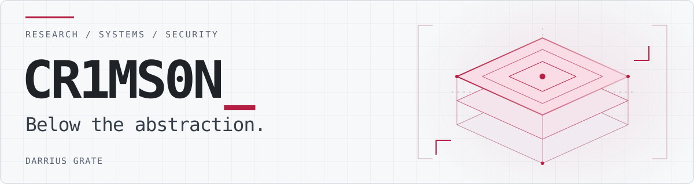

<picture>
  <source media="(prefers-color-scheme: dark)" srcset="assets/banner-dark.svg">
  <source media="(prefers-color-scheme: light)" srcset="assets/banner-light.svg">
  
</picture>

# Darrius Grate

**Security researcher · Systems builder · `@CR1MS0N-Operator`**

I build reproducible operator workstations, security tooling, and the research behind them. My focus is turning complex security workflows into systems that can be understood, repeated, and validated.

[Portfolio](https://azraelsecurity.vercel.app) · [Research](https://github.com/CR1MS0N-Operator/security-research) · [All repositories](https://github.com/CR1MS0N-Operator?tab=repositories)

## Selected work

The environment I work in, the tooling I build, and where I share the results.

### 01 / [NightForge](https://github.com/CR1MS0N-Operator/nightforge)

**The operator workstation.** A reproducible Omarchy-based environment bringing security work and AI agent orchestration together, with rootless Podman toolchains and a validation harness.

`Linux` `Go` `Podman` · [Explore NightForge](https://github.com/CR1MS0N-Operator/nightforge#readme)

### 02 / [C4](https://github.com/CR1MS0N-Operator/c4)

**The control plane.** A Go CLI for managing the lifecycle of C2 infrastructure in adversary-emulation environments. Compose-backed orchestration, provider abstractions, and scriptable output.

`Go` `Docker Compose` `GraphQL` · [Explore C4](https://github.com/CR1MS0N-Operator/c4#readme)

### 03 / [Azrael Security](https://azraelsecurity.vercel.app)

**The public portfolio.** Research, projects, and technical writeups, presented through an interactive terminal and a MITRE ATT&CK coverage explorer.

`Next.js` `TypeScript` `Tailwind CSS` · [Visit Azrael Security](https://azraelsecurity.vercel.app)

## Below the surface

- **[Container boundary research](https://github.com/CR1MS0N-Operator/security-research)** — Original analysis of NVIDIA Container Toolkit isolation failures and rootless Podman boundaries.
- **[Lant3rn](https://github.com/CR1MS0N-Operator/Lant3rn)** — Active Directory permission auditing with LDAP enumeration, ATT&CK-mapped risk scoring, and structured output.

Certifications &amp; community

### Completed certifications

- **Active Directory Red Team Specialist (AD-RTS)** — CyberWarfare Labs
- **Certified Associate Penetration Tester (CAPT)** — HackViser
- **Certified Offensive Security Junior (COSJ)** — RedTeam Ops

### Community

- **OWASP Las Vegas** — Chapter Leader, December 2025–March 2026
- **HackSpaceCon 2026** — Volunteer

---

Reproducible environments. Inspectable tooling. Research below the abstraction.
